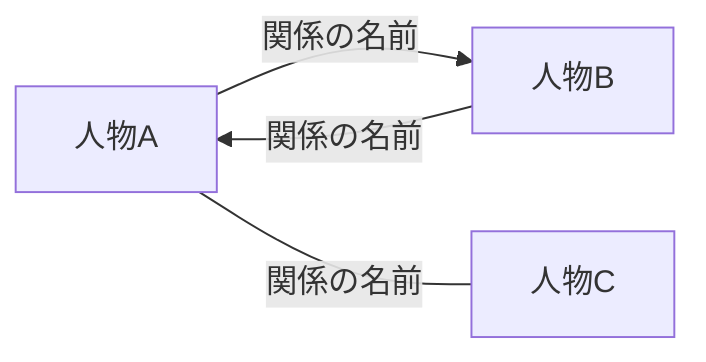

# フェーズ4：相関関係図｜{{物語名}}

> 図は見やすさのための補助。**食い違いがあれば、下の表を正とする。**

## 相関関係図（物語開始時点）

<!-- 矢印は感情・働きかけの向き、線のみ（---）は対等な関係。 -->

## 関係の一覧（物語開始時点）

| 人物A | 人物B | 関係 | AからBへの感情 | BからAへの感情 | 備考 |
|---|---|---|---|---|---|
| | | | | | |

## 章ごとの関係変化

関係が変わる箇所をここに書く。フェーズ6で、各章の起承転結がこの表と矛盾しないかを確認する基準になる。

| 章 | 人物A | 人物B | 変化前 | 変化後 | きっかけ |
|---|---|---|---|---|---|
| 第◯章 | | | | | |

## 人物の登場・退場

| 人物 | 初登場の章 | 退場の章（なければ「-」） | 退場の理由 |
|---|---|---|---|
| | | | |
